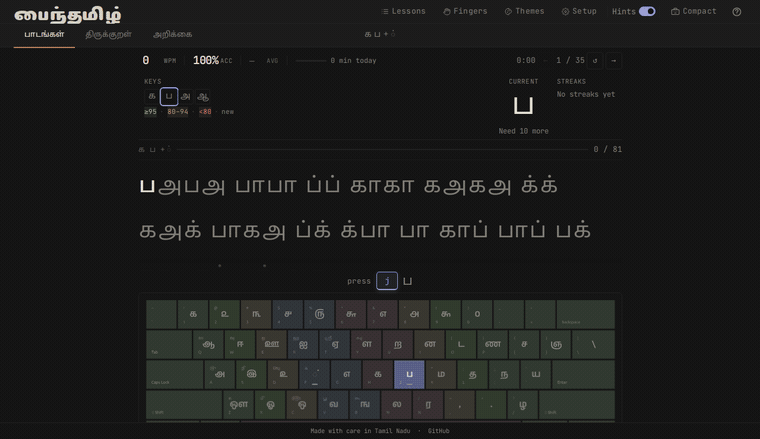

<div align="center">
#பைந்தமிழ் · Payinthamil

**தமிழ்99 விசைப்பலகையில் தமிழ்த் தட்டச்சுப் பயிற்சி**

*A Tamil99 keyboard typing trainer*

[](LICENSE)


</div>

<div align="center">
  
</div>

---

## தமிழ்

### பைந்தமிழ் என்றால் என்ன?

பைந்தமிழ் என்பது **தமிழ்99 விசைப்பலகையைப் பயன்படுத்தித் தமிழில் தட்டச்சு செய்யப் பழகுவதற்கான இலவச, திறந்த மூல இணையச் செயலி.**

விசைப்பலகையின் நடுவரிசையில் தொடங்கி, ஒவ்வொரு விசையாக அறிமுகப்படுத்திப் படிப்படியாகத் தட்டச்சுப் பழகலாம். உயிரெழுத்துகள், மெய்யெழுத்துகள், உயிர்மெய்யெழுத்துகள் என அடிப்படையிலிருந்து தொடங்கி, முழு விசைப்பலகையையும் பயன்படுத்திப் பழகுவதற்கு மொத்தம் 35 பாடங்கள் உள்ளன.

உங்கள் தட்டச்சுப் பயிற்சி விவரங்களும் விருப்ப அமைப்புகளும் உங்கள் உலாவியிலேயே சேமிக்கப்படும். கணக்கு தொடங்கவோ பதிவு செய்யவோ தேவையில்லை. திருக்குறள் பயிற்சிக்குத் தேவையான குறள்கள் இணையத்திலிருந்து பெறப்படுகின்றன; இணைய இணைப்பு இல்லாதபோதும் 10 குறள்களைப் பயன்படுத்தலாம்.

> **குறிப்பு:** பைந்தமிழ் கணினியின் இயற்பியல் விசைப்பலகையில் தட்டச்சுப் பழகுவதற்காக உருவாக்கப்பட்டது. கைபேசித் திரை விசைப்பலகைகளில் இதைப் பயன்படுத்த முடியாது. கணினி அல்லது மடிக்கணினியில் திறக்கவும்.

### சிறப்பம்சங்கள்

| சிறப்பம்சம் | விவரம் |
|---|---|
| **35 பாடங்கள்** | தொடக்கநிலை 20 · இடைநிலை 8 · மேல்நிலை 7 |
| **படிப்படியான பயிற்சி** | அறிமுகப்படுத்திய விசைகளை மட்டுமே கொண்டு அடுத்தடுத்த பயிற்சிகள் அமையும் |
| **உயிர்மெய் எழுத்துப் பயிற்சி** | ஒவ்வொரு மெய்யெழுத்துடனும் 12 உயிரெழுத்துகளையும் சேர்த்துப் பழகலாம் |
| **திருக்குறள் பயிற்சி** | 1330 குறள்களில் எதையும் தேர்ந்தெடுத்துத் தட்டச்சு செய்யலாம். இணையம் தேவை; இணையமின்றி 10 குறள்கள் கிடைக்கும் |
| **விரல் வழிகாட்டி** | எந்த விசையை எந்த விரலால் அழுத்த வேண்டும் என்பதை வண்ணங்களுடன் காட்டும் |
| **தட்டச்சு விவரங்கள்** | தட்டச்சு வேகம் (WPM), துல்லியம், ஒவ்வொரு விசைக்குமான தட்டச்சு நேரம் |
| **பயிற்சி அறிக்கை** | உங்கள் முன்னேற்றத்தை PDF ஆகப் பதிவிறக்கலாம் |
| **16 வண்ணத் தோற்றங்கள்** | விருப்பமான வண்ணங்களையும் எழுத்துருவையும் தேர்ந்தெடுக்கலாம் |

### பாடங்கள்

மொத்தம் 35 பாடங்கள் மூன்று நிலைகளாகப் பிரிக்கப்பட்டுள்ளன.

**தொடக்கநிலை (20 பாடங்கள்)**

விசைப்பலகையின் நடுவரிசையில் உள்ள `க`, `ப` ஆகிய விசைகளில் புள்ளி `்` உடன் தொடங்குகிறது. முதல் பாடத்திலேயே `கல்` போன்ற சொற்களைத் தட்டச்சு செய்து பழகலாம்.

அடுத்து `ம`, `த`, `ந`, `ய` ஆகிய விசைகள் அறிமுகப்படுத்தப்பட்டு நடுவரிசை முழுமையடைகிறது.

பின்னர் 12 உயிரெழுத்துகளும் ஜோடி ஜோடியாக அறிமுகப்படுத்தப்படுகின்றன. தொடர்ந்து, பயன்பாட்டின் அடிப்படையில் வரிசைப்படுத்தப்பட்ட மற்ற மெய்யெழுத்துகள் கற்றுத்தரப்படுகின்றன. இறுதியில் உயிர்மெய் எழுத்துகளுக்கான பயிற்சிகள் இடம்பெறுகின்றன.

**இடைநிலை (8 பாடங்கள்)**

மீதமுள்ள உயிர்மெய் எழுத்துச் சேர்க்கைகளுக்கான பயிற்சிகள் தொடர்ந்து இடம்பெறும். பின்னர் 24 முதல் 30 WPM வரையிலான தட்டச்சு வேகப் பயிற்சிகள் உள்ளன.

**மேல்நிலை (7 பாடங்கள்)**

கிரந்த எழுத்துகளான `ஸ`, `ஷ`, `ஜ`, `ஹ`, ஆய்த எழுத்து `ஃ` ஆகியவற்றுடன் பயிற்சி செய்யலாம். மேலும், 40 WPM வரை வேகப் பயிற்சிகளும், தமிழ் கணக்குக் குறியீடுகளான `௳ ௴ ௵ ௶ ௷ ௸ ௹ ௺` ஆகியவற்றுக்கான பயிற்சிகளும் உள்ளன.

### பயன்படுத்துவது எப்படி?

பைந்தமிழைப் பயன்படுத்த எந்தவிதமான கட்டமைப்பு (build) செயல்முறையும் தேவையில்லை. ஆனால், இது ES modules பயன்படுத்துவதால் `file://` வழியாக நேரடியாகத் திறக்க முடியாது. உள்ளூர் HTTP சேவையகம் தேவை.

```bash
git clone https://github.com/siruththondan/Payinthamil.git
cd Payinthamil
python3 -m http.server 5501
```

உங்கள் உலாவியில் **http://localhost:5501** என்ற முகவரியைத் திறக்கவும்.

<details>
<summary>வேறு வழிகள்</summary>

Node.js பயன்படுத்துபவர்கள்:

```bash
npx serve -l 5501
```

PHP பயன்படுத்துபவர்கள்:

```bash
php -S localhost:5501
```

VS Code பயன்படுத்தினால் **Live Server** நீட்சியையும் பயன்படுத்தலாம்.

</details>

### பங்களிப்பு

புதிய பாடங்கள், தமிழ்ச் சொற்கள், வண்ணத் தோற்றங்கள், பிழைத் திருத்தங்கள், ஆவண மேம்பாடுகள் என அனைத்து வகையான பங்களிப்புகளும் வரவேற்கப்படுகின்றன.

1. Repository-ஐ Fork செய்யவும்.
2. புதிய கிளையை உருவாக்கவும்: `git checkout -b my-feature`
3. தேவையான மாற்றங்களைச் செய்து உலாவியில் சோதிக்கவும்.
4. `npm run check` இயக்கிப் பிழைகள் ஏதுமில்லையா எனச் சரிபார்க்கவும்.
5. Pull Request அனுப்பவும்.

மேலும் விவரங்களுக்கு [CONTRIBUTING.md](CONTRIBUTING.md) பார்க்கவும்.

- [நடத்தை விதிகள்](CODE_OF_CONDUCT.md)
- [பாதுகாப்புக் குறைபாடுகளைப் புகாரளித்தல்](SECURITY.md)

பயன்படுத்தும்போது ஏதேனும் பிழை ஏற்பட்டால் [Issue ஒன்றைத் திறக்கவும்](https://github.com/siruththondan/Payinthamil/issues). உங்கள் உலாவி, திரை அளவு மற்றும் ஏற்பட்ட சிக்கலைப் பற்றிய விவரங்களையும் குறிப்பிடவும்.

---

## English

### What is Payinthamil?

Payinthamil is a **free, open-source web application for learning to touch-type Tamil using the Tamil99 keyboard layout.**

It starts with the home row and introduces one key at a time across 35 structured lessons, gradually covering the entire keyboard.

Your typing progress and preferences are stored locally in your browser. No account or sign-up is required. Thirukkural verses are retrieved from an external API, with 10 verses available offline.

> **Note:** Payinthamil is designed for physical keyboards. Touchscreen keyboards have no fixed key positions, so the application is not intended for phones. Use it on a desktop or laptop.

### Features

| Feature | Description |
|---|---|
| **35 lessons** | 20 beginner · 8 intermediate · 7 advanced |
| **Progressive learning** | A key never appears in an exercise before it has been introduced |
| **Uyirmei practice** | Every consonant combined with all 12 vowels |
| **Thirukkural mode** | Type any of the 1,330 verses (internet required; 10 saved verses available offline) |
| **Finger guide** | Colour-coded finger-to-key zones |
| **Live metrics** | WPM, accuracy, and per-key timing (EMA-smoothed) |
| **Progress report** | Export your progress as a PDF |
| **16 themes** | Custom colours and font switching |

### Curriculum

The 35 lessons are organised into three levels.

**Beginner (20 lessons)**

The course opens with `க` and `ப` on the home row, along with the pulli `்`. Real words such as `கல்` appear from the very first lesson.

Then `ம`, `த`, `ந`, and `ய` complete the home row. All 12 vowels follow in pairs, then the remaining consonants are introduced in order of usage frequency. The beginner level concludes with Uyirmei (consonant + vowel) practice.

**Intermediate (8 lessons)**

Practise the remaining Uyirmei combinations, followed by speed exercises ranging from 24 to 30 WPM.

**Advanced (7 lessons)**

Covers Grantha letters `ஸ ஷ ஜ ஹ`, the aytham `ஃ`, speed exercises up to 40 WPM, and Tamil accounting symbols `௳ ௴ ௵ ௶ ௷ ௸ ௹ ௺`.

### Running it

No build step is required. However, the application uses ES modules, so opening it through `file://` will not work. You need an HTTP server.

```bash
git clone https://github.com/siruththondan/Payinthamil.git
cd Payinthamil
python3 -m http.server 5501
```

Open **http://localhost:5501** in your browser.

<details>
<summary>Alternative ways to run locally</summary>

Using Node.js:

```bash
npx serve -l 5501
```

Using PHP:

```bash
php -S localhost:5501
```

If you use VS Code, you can also use the **Live Server** extension.

</details>

### Deploying

Payinthamil is a static web application. Push the project directory as-is to any static hosting provider, such as GitHub Pages, Netlify, Vercel, or Cloudflare Pages. There is nothing to compile.

#### Compression

Enable Gzip or Brotli compression for better loading performance.

Compression reduces the payload from approximately **269 KB to 105 KB**. This makes a significant difference to loading performance, and major static hosting providers enable it by default.

Per-host notes:

- **Netlify, Vercel, Cloudflare Pages, GitHub Pages:** Text assets (HTML, CSS, JavaScript and SVG) are compressed automatically. Nothing to configure.
- **Self-hosted nginx / Apache / Caddy:** Enable Gzip or Brotli for `text/html`, `text/css`, `text/javascript` and `image/svg+xml`.

To verify that compression is enabled:

```bash
curl -sI -H 'Accept-Encoding: br,gzip' \
  https://HOST/styles/style.css | grep -i content-encoding
```

You should see `content-encoding: br` or `gzip`.

#### Caching

Every JavaScript file, the stylesheet, the keyboard SVG and the keyboard module graph are requested with `?v=<version>`. This allows them to be cached for a long time without visitors receiving outdated files.

Whenever you make changes that affect these assets, bump the corresponding version strings. See the checklist in `CONTRIBUTING.md`.

`index.html` itself must be revalidated so visitors receive the latest version string.

Example `netlify.toml` configuration (the project does not ship with a host-specific configuration):

```toml
[[headers]]
  for = "/index.html"
  [headers.values]
    Cache-Control = "public, max-age=0, must-revalidate"

[[headers]]
  for = "/js/*"
  [headers.values]
    Cache-Control = "public, max-age=31536000, immutable"

[[headers]]
  for = "/styles/*"
  [headers.values]
    Cache-Control = "public, max-age=31536000, immutable"

[[headers]]
  for = "/assets/*"
  [headers.values]
    Cache-Control = "public, max-age=31536000, immutable"
```

For other hosting providers, configure equivalent `Cache-Control` headers using their respective mechanisms:

- Cloudflare Pages: `_headers`
- Vercel: `vercel.json` with `headers`

### Project layout

```text
Payinthamil/
├── index.html              Single page — all markup
├── styles/
│   └── style.css           All styles, CSS custom properties for theming
├── assets/
│   ├── images/
│   │   ├── Tamil99.svg     Keyboard graphic (every key has an addressable ID)
│   │   └── preview.webp    Preview image (.gif fallback)
│   └── fonts/
│       ├── nst-ta.woff2
│       ├── jbm-ui.woff2
│       ├── coiny-logo.woff2
│       ├── OFL.txt         Font license
│       └── README.md       Per-file font source notes
├── tools/
│   └── mkcrit.py           Regenerates inline critical CSS in index.html
├── scripts/
│   └── check.mjs           npm run check: syntax, version strings, file references
├── .github/                CI workflow, issue forms, pull request template
├── js/
│   ├── practice.js         Entry point, lesson engine, tab routing
│   ├── lessons.js          35 lessons + Tamil word database
│   ├── mapping.js          Tamil99 key ↔ glyph maps, syllable composition
│   ├── keyboard.js         SVG injection, key highlighting
│   ├── metrics.js          WPM, accuracy, per-key statistics
│   ├── storage.js          localStorage wrapper (buffered writes)
│   ├── themes.js           16 themes + custom theme variables
│   ├── thirukkural.js      Thirukkural mode (lazy-loaded)
│   ├── report.js           Progress report (lazy-loaded)
│   ├── tour.js             12-step onboarding (lazy-loaded)
│   └── fingerGuide.js      Finger-zone overlay
├── package.json            Scripts only (start, check); no dependencies
├── CONTRIBUTING.md         How to run, style, contribute and release checklist
├── CODE_OF_CONDUCT.md      Contributor Covenant 2.1
├── SECURITY.md             How to report vulnerabilities
├── CHANGELOG.md            Release notes
├── NOTICE                  Third-party notices
└── LICENSE                 Apache 2.0 license
```

### Technical notes

- **No framework, no bundler.** Payinthamil uses native JavaScript ES modules loaded directly by the browser. Clone it, explore the source and run it — there is no build output to decode.

- **Lazy loading.** `thirukkural.js`, `report.js` and `tour.js` are loaded only when needed. This keeps the initial application payload to 8 files. On a gated (phone) device, the application JavaScript and keyboard SVG are not fetched at all.

- **Fast first paint without a build step.** The first-frame CSS is inlined in `index.html` and mirrors `styles/style.css`. Both must be kept in sync. The full stylesheet loads without blocking the initial render. The import map and module preloads are included in `<head>`.

- **Self-hosted fonts.** No third-party font requests are required. The application uses:
  - Noto Sans Tamil as a variable font.
  - JetBrains Mono as a variable font.
  - A Coiny subset containing only the glyphs used in the logo.

  Changing the logo text requires regenerating `assets/fonts/coiny-logo.woff2`. The regeneration command is documented in `index.html`.

- **Efficient keystroke handling.** Per-key statistics are buffered in memory and flushed during idle time, when the tab becomes hidden, or when a lesson ends. They are never synchronously written on every keypress. Measured at approximately **100 µs per keystroke with zero forced reflows**.

- **Theme system.** Themes are implemented using CSS custom properties and applied inline through `applyTheme()`. All 16 built-in themes meet WCAG AA contrast requirements for muted text.

- **Tamil text normalisation.** Tamil text is NFC-normalised before key mapping, so copy-pasted text from different sources is handled consistently.

### Contributing

Contributions of every kind are welcome, including new lessons, additional Tamil vocabulary, themes, bug fixes, documentation and accessibility improvements.

To contribute:

1. Fork the repository.
2. Create a branch: `git checkout -b my-feature`
3. Make your changes and test them in a browser.
4. Run `npm run check` to verify syntax, version strings and file references. No dependency installation is needed; Node.js is sufficient.
5. Open a Pull Request.

Please read [CONTRIBUTING.md](CONTRIBUTING.md) for details.

Also see:
- [Code of Conduct](CODE_OF_CONDUCT.md)
- [Security Policy](SECURITY.md)

Found a bug? [Open an issue](https://github.com/siruththondan/Payinthamil/issues) with your browser, screen size and a description of what happened.

### Roadmap

- **Complete offline Thirukkural support:** Bundle all 1,330 Thirukkural verses into the application so that the feature works fully offline without depending on the third-party Kural API.

---

## Credits

- **Thirukkural text:** [Tamil Kural API](https://tamil-kural-api.vercel.app), with a locally bundled fallback for offline use.
- **Fonts:** Self-hosted subsets distributed under the SIL Open Font License (OFL).
  - [Noto Sans Tamil](https://fonts.google.com/noto/specimen/Noto+Sans+Tamil)
  - [JetBrains Mono](https://www.jetbrains.com/lp/mono/)
  - [Coiny](https://fonts.google.com/specimen/Coiny)
- **Tamil99 keyboard layout:** Based on the Tamil Nadu Government standard.

## License

[Apache License 2.0](LICENSE) — Free to use, modify and distribute under the terms of the license.

<div align="center">

*Made in Tamil Nadu · with ❤️ · Siruththondan*

**தமிழ்நாட்டில் உருவாக்கப்பட்டது · அன்புடன் ♥️ · சிறுத்தொண்டன்**

</div>
